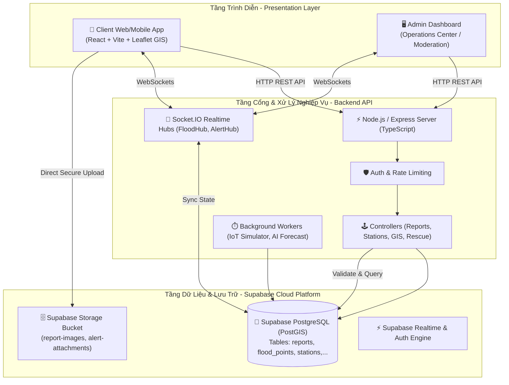
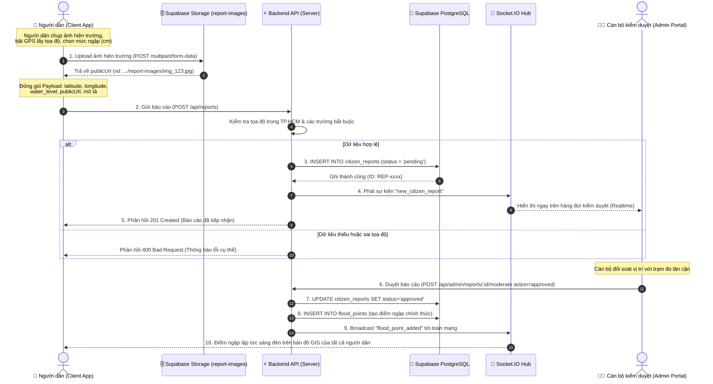

# Kiến Trúc Hệ Thống (System Architecture)
## Hệ Thống Cảnh Báo Ngập Lụt Đô Thị Thông Minh (Smart Flood Warning System)

---

## 1. Tổng Quan Kiến Trúc (High-Level Architecture)

Hệ thống được thiết kế theo mô hình **Phân lớp Hướng Dịch vụ (Layered Service-Oriented Architecture)** kết hợp cơ chế **Hướng Sự kiện Thời gian thực (Event-Driven Realtime)** nhằm phục vụ đồng thời hai nhóm đối tượng:
- **Người dân (Citizens / Mobile & Web Portal)**: Tra cứu bản đồ ngập, lộ trình an toàn, gửi báo cáo ngập hiện trường và gửi yêu cầu cứu nạn SOS 114.
- **Ban Chỉ huy & Quản trị viên (Command & Operations Center)**: Giám sát mạng lưới trạm quan trắc IoT, duyệt tin báo ngập cộng đồng, ban hành bản tin khẩn cấp và điều phối cứu hộ.

---

## 2. Mô Tả Luồng Dữ Liệu (Data Flow)

1. **Luồng Cổng thông tin (Client $\rightarrow$ Backend $\rightarrow$ Database)**:
   - Client gửi các yêu cầu truy vấn bản đồ, danh sách trạm đo, lịch sử triều cường qua REST API.
   - Backend xác thực, kiểm tra rate limit, truy vấn từ cơ sở dữ liệu Supabase PostgreSQL và trả về định dạng GeoJSON / JSON chuẩn.

2. **Luồng Dữ liệu Thời gian thực (Realtime Ingestion & Broadcast)**:
   - Các trạm quan trắc IoT (và Background Simulator) cập nhật lượng mưa, mực nước triều theo chu kỳ 5 phút.
   - Nếu mực nước vượt ngưỡng Báo động 3, `WeatherAlertEngine` tự động phát sinh bản tin khẩn cấp và kích hoạt `AlertNotificationHub` đẩy cảnh báo tức thì qua WebSocket tới toàn bộ người dân trong vùng ảnh hưởng.

3. **Luồng Báo cáo Cộng đồng (Crowdsourced Reporting Flow)**:
   - Ảnh chụp hiện trường được tải trực tiếp lên **Supabase Storage** (`report-images`) để tối ưu hóa băng thông cho Backend.
   - Metadata của báo cáo (tọa độ GPS, mức ngập, URL ảnh) được gửi về Backend xử lý và lưu vào bảng `citizen_reports`.

---

## 3. Sơ Đồ Tương Tác: Người Dân Gửi Báo Cáo Ngập

Quy trình chi tiết từ lúc người dân ghi nhận ngập lụt ngoài hiện trường cho đến khi điểm ngập được phê duyệt và hiển thị trên bản đồ số GIS toàn thành phố:

---

## 4. Các Biện Pháp Đảm Bảo Tính Toàn Vẹn & Hiệu Năng
- **Phân tách tải lưu trữ tệp (Media Offloading)**: Ảnh hiện trường được đẩy trực tiếp lên Cloud Storage (CDN), máy chủ ứng dụng chỉ xử lý dữ liệu JSON có cấu trúc.
- **Kiểm soát tọa độ địa lý (Geofencing Validation)**: Mọi tọa độ gửi lên đều được xác thực nằm trong Bounding Box của khu vực TP.HCM (vĩ độ $10.35 - 11.20$, kinh độ $106.35 - 107.05$) trước khi ghi vào CSDL.
- **Cơ chế Chống nghẽn (Rate Limiting)**: Giới hạn tối đa 120 requests/phút trên mỗi địa chỉ IP để chống spam và tấn công từ chối dịch vụ (DDoS) khi có bão lũ lớn.
