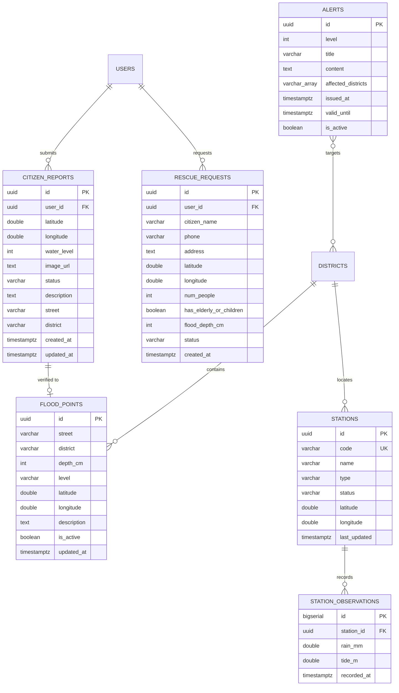

# Thiết Kế Cơ Sở Dữ Liệu (Database Schema Design)
## Hệ Thống Cảnh Báo Ngập Lụt Đô Thị Thông Minh (Supabase PostgreSQL + PostGIS)

---

## 1. Sơ Đồ Thực Thể - Quan Hệ (ERD Overview)



---

## 2. Chi Tiết Cấu Trúc Bảng Báo Cáo Ngập (`citizen_reports` / `reports`)

Bảng lưu trữ thông tin báo cáo ngập lụt được người dân gửi từ hiện trường:

| Tên Cột | Kiểu Dữ Liệu | Ràng Buộc (Constraints) | Ý Nghĩa / Mô Tả |
| :--- | :--- | :--- | :--- |
| `id` | `UUID` | `PRIMARY KEY DEFAULT gen_random_uuid()` | Khóa chính định danh báo cáo |
| `user_id` | `UUID` | `NULLABLE REFERENCES auth.users(id)` | Khóa ngoại người gửi (nếu đã đăng nhập tài khoản) |
| `latitude` | `DOUBLE PRECISION` | `NOT NULL`, `CHECK (latitude BETWEEN 10.35 AND 11.20)` | Vĩ độ WGS84 trong địa giới TP.HCM |
| `longitude` | `DOUBLE PRECISION` | `NOT NULL`, `CHECK (longitude BETWEEN 106.35 AND 107.05)` | Kinh độ WGS84 trong địa giới TP.HCM |
| `water_level` | `INTEGER` | `NOT NULL`, `CHECK (water_level > 0)` | Mức ngập ước lượng tính bằng cm |
| `image_url` | `TEXT` | `NULLABLE` | Đường dẫn ảnh hiện trường trên Supabase Storage |
| `street` | `VARCHAR(255)` | `NULLABLE` | Tên tuyến đường xảy ra ngập |
| `district` | `VARCHAR(100)` | `NULLABLE` | Tên Quận/Huyện |
| `description` | `TEXT` | `NULLABLE` | Ghi chú thêm (xe chết máy, dòng nước xiết,...) |
| `status` | `VARCHAR(20)` | `NOT NULL DEFAULT 'pending'`, `CHECK (status IN ('pending', 'approved', 'rejected'))` | Trạng thái kiểm duyệt: Chờ duyệt, Đã duyệt, Từ chối |
| `reviewed_by` | `UUID` | `NULLABLE REFERENCES auth.users(id)` | Cán bộ kiểm duyệt báo cáo này |
| `reviewed_at` | `TIMESTAMPTZ` | `NULLABLE` | Thời điểm kiểm duyệt |
| `created_at` | `TIMESTAMPTZ` | `NOT NULL DEFAULT NOW()` | Thời gian tạo báo cáo |
| `updated_at` | `TIMESTAMPTZ` | `NOT NULL DEFAULT NOW()` | Thời gian cập nhật lần cuối |

### Các chỉ mục (Indexes) trên bảng `citizen_reports`:
1. `idx_citizen_reports_status`: Index trên cột `status` để tối ưu truy vấn hàng đợi chờ duyệt của cán bộ.
2. `idx_citizen_reports_created_at`: Index sắp xếp giảm dần theo thời gian báo cáo.
3. `idx_citizen_reports_coords`: Composite index `(latitude, longitude)` phục vụ đối soát vị trí nhanh.

---

## 3. Các Bảng Liên Quan Trong Hệ Thống

### 3.1. Bảng `flood_points` (Điểm ngập chính thức trên bản đồ GIS)
- Chứa các điểm ngập đã qua kiểm duyệt hoặc do ban chỉ huy công bố trực tiếp lên bản đồ cho toàn dân.
- Cột phân loại mức độ ngập `level`: `warning` (10-20cm), `danger` (20-40cm), `critical` (>40cm).

### 3.2. Bảng `stations` (Mạng lưới trạm quan trắc IoT)
- Định danh trạm qua `code` duy nhất (ví dụ: `TRAM-PHUAN`, `TRAM-NHABE`).
- Phân loại trạm `type`: `rain` (đo mưa), `tide` (đo triều), `combined` (kết hợp cả hai).
- Trạng thái hoạt động `status`: `online`, `offline`, `maintenance`.

### 3.3. Bảng `station_observations` (Nhật ký quan trắc chu kỳ 5 phút)
- Lưu lịch sử chuỗi thời gian (Time-series data) về vũ lượng mưa (`rain_mm`) và mực nước triều cường (`tide_m`).

### 3.4. Bảng `rescue_requests` (Yêu cầu cứu hộ khẩn cấp 114)
- Ghi nhận số lượng người mắc kẹt (`num_people`), có người già/trẻ em (`has_elderly_or_children`), mức ngập trong nhà (`flood_depth_cm`).
- Trạng thái điều phối: `pending` $\rightarrow$ `assigned` $\rightarrow$ `in_progress` $\rightarrow$ `completed`.

---

## 4. Script SQL Migration Hoàn Chỉnh (Chạy trên Supabase SQL Editor)

```sql
-- Kích hoạt extension PostGIS & sinh UUID
CREATE EXTENSION IF NOT EXISTS "uuid-ossp";
CREATE EXTENSION IF NOT EXISTS "postgis";

-- 1. BẢNG BÁO CÁO NGẬP CỘNG ĐỒNG (citizen_reports)
CREATE TABLE IF NOT EXISTS public.citizen_reports (
    id UUID PRIMARY KEY DEFAULT uuid_generate_v4(),
    user_id UUID,
    latitude DOUBLE PRECISION NOT NULL CHECK (latitude BETWEEN 10.35 AND 11.20),
    longitude DOUBLE PRECISION NOT NULL CHECK (longitude BETWEEN 106.35 AND 107.05),
    water_level INTEGER NOT NULL CHECK (water_level > 0),
    image_url TEXT,
    street VARCHAR(255),
    district VARCHAR(100),
    description TEXT,
    status VARCHAR(20) NOT NULL DEFAULT 'pending' CHECK (status IN ('pending', 'approved', 'rejected')),
    reviewed_by UUID,
    reviewed_at TIMESTAMPTZ,
    created_at TIMESTAMPTZ NOT NULL DEFAULT TIMEZONE('utc'::text, NOW()),
    updated_at TIMESTAMPTZ NOT NULL DEFAULT TIMEZONE('utc'::text, NOW())
);

-- Chỉ mục tối ưu truy vấn
CREATE INDEX IF NOT EXISTS idx_citizen_reports_status ON public.citizen_reports(status);
CREATE INDEX IF NOT EXISTS idx_citizen_reports_created ON public.citizen_reports(created_at DESC);
CREATE INDEX IF NOT EXISTS idx_citizen_reports_coords ON public.citizen_reports(latitude, longitude);

-- 2. BẢNG ĐIỂM NGẬP TRÊN BẢN ĐỒ GIS (flood_points)
CREATE TABLE IF NOT EXISTS public.flood_points (
    id UUID PRIMARY KEY DEFAULT uuid_generate_v4(),
    street VARCHAR(255) NOT NULL,
    district VARCHAR(100) NOT NULL,
    depth_cm INTEGER NOT NULL CHECK (depth_cm > 0),
    level VARCHAR(20) NOT NULL CHECK (level IN ('info', 'warning', 'danger', 'critical')),
    latitude DOUBLE PRECISION NOT NULL,
    longitude DOUBLE PRECISION NOT NULL,
    description TEXT,
    is_active BOOLEAN NOT NULL DEFAULT true,
    created_at TIMESTAMPTZ NOT NULL DEFAULT TIMEZONE('utc'::text, NOW()),
    updated_at TIMESTAMPTZ NOT NULL DEFAULT TIMEZONE('utc'::text, NOW())
);

-- 3. BẢNG TRẠM QUAN TRẮC IOT (stations)
CREATE TABLE IF NOT EXISTS public.stations (
    id UUID PRIMARY KEY DEFAULT uuid_generate_v4(),
    code VARCHAR(50) NOT NULL UNIQUE,
    name VARCHAR(255) NOT NULL,
    type VARCHAR(30) NOT NULL CHECK (type IN ('rain', 'tide', 'combined')),
    status VARCHAR(20) NOT NULL DEFAULT 'online' CHECK (status IN ('online', 'offline', 'maintenance')),
    latitude DOUBLE PRECISION NOT NULL,
    longitude DOUBLE PRECISION NOT NULL,
    current_rain_mm DOUBLE PRECISION DEFAULT 0.0,
    current_tide_m DOUBLE PRECISION DEFAULT 0.0,
    last_updated TIMESTAMPTZ NOT NULL DEFAULT TIMEZONE('utc'::text, NOW())
);

-- 4. BẢNG YÊU CẦU CỨU NẠN KHẨN CẤP 114 (rescue_requests)
CREATE TABLE IF NOT EXISTS public.rescue_requests (
    id UUID PRIMARY KEY DEFAULT uuid_generate_v4(),
    user_id UUID,
    citizen_name VARCHAR(150) NOT NULL,
    phone VARCHAR(20) NOT NULL,
    address TEXT NOT NULL,
    latitude DOUBLE PRECISION NOT NULL,
    longitude DOUBLE PRECISION NOT NULL,
    num_people INTEGER NOT NULL DEFAULT 1 CHECK (num_people > 0),
    has_elderly_or_children BOOLEAN NOT NULL DEFAULT false,
    flood_depth_cm INTEGER NOT NULL CHECK (flood_depth_cm > 0),
    status VARCHAR(20) NOT NULL DEFAULT 'pending' CHECK (status IN ('pending', 'assigned', 'in_progress', 'completed')),
    dispatched_unit VARCHAR(100),
    created_at TIMESTAMPTZ NOT NULL DEFAULT TIMEZONE('utc'::text, NOW()),
    updated_at TIMESTAMPTZ NOT NULL DEFAULT TIMEZONE('utc'::text, NOW())
);

-- 5. BẢNG BẢN TIN CẢNH BÁO THIÊN TAI (alerts)
CREATE TABLE IF NOT EXISTS public.alerts (
    id UUID PRIMARY KEY DEFAULT uuid_generate_v4(),
    level INTEGER NOT NULL CHECK (level BETWEEN 1 AND 5),
    title VARCHAR(255) NOT NULL,
    content TEXT NOT NULL,
    affected_districts TEXT[] DEFAULT '{}',
    is_active BOOLEAN NOT NULL DEFAULT true,
    issued_at TIMESTAMPTZ NOT NULL DEFAULT TIMEZONE('utc'::text, NOW()),
    valid_until TIMESTAMPTZ NOT NULL
);

-- Thiết lập Row Level Security (RLS) mẫu
ALTER TABLE public.citizen_reports ENABLE ROW LEVEL SECURITY;

-- Cho phép người dân gửi báo cáo ngập công khai
CREATE POLICY "Public can submit citizen reports"
ON public.citizen_reports FOR INSERT
WITH CHECK (true);

-- Cho phép mọi người đọc báo cáo đã được duyệt
CREATE POLICY "Public can view approved reports"
ON public.citizen_reports FOR SELECT
USING (status = 'approved');
```
