# Kiến Trúc Mô Hình MVC (Model - View - Controller)
## Hệ Thống Cảnh Báo Ngập Lụt Đô Thị Thông Minh (Smart Flood Warning System)

---

## 1. Tổng Quan Mô Hình MVC Trong Hệ Thống

Dự án áp dụng mô hình kiến trúc **MVC (Model - View - Controller)** kết hợp với mô hình **Web Decoupled (RESTful API + Single Page Applications)** chuẩn công nghiệp hiện đại:

```mermaid
flowchart LR
    subgraph VIEW ["🖥️ VIEW (Tầng Trình Diễn)"]
        ClientApp["Client Web App (Người dân)<br/>React + Leaflet GIS + Vite"]
        AdminApp["Admin Dashboard (Ban chỉ huy)<br/>React + Charts + Leaflet"]
    end

    subgraph CONTROLLER ["🕹️ CONTROLLER & ROUTER (Tầng Điều Hướng & Tiếp Nhận)"]
        RouterLayer["Routes Layer (server/src/routes/)<br/>auth, stations, reports, alerts,..."]
        ControllerLayer["Controllers (server/src/controllers/)<br/>CitizenReportsController, StationsController,..."]
    end

    subgraph MODEL ["🐘 MODEL & SERVICES (Tầng Dữ Liệu & Nghiệp Vụ)"]
        Entities["Entities & Models (server/src/models/)<br/>CitizenReport, Station, Alert, FloodPoint..."]
        Services["Business Services (server/src/services/)<br/>GisSpatialService, WeatherAlertEngine..."]
        Database[("Supabase PostgreSQL / PostGIS")]
    end

    VIEW -->|1. HTTP Request / Form Submit| RouterLayer
    RouterLayer -->|2. Dispatch action| ControllerLayer
    ControllerLayer -->|3. Gọi Service & Model| Services
    Services -->|4. Truy vấn / Cập nhật| Entities
    Entities <-->|5. Lưu trữ / Đồng bộ| Database
    ControllerLayer -->|6. Trả về JSON / GeoJSON| VIEW
```

---

## 2. Chi Tiết Các Thành Phần MVC

### 📌 1. MODEL (Dữ Liệu & Logic Nghiệp Vụ)
Chịu trách nhiệm định nghĩa cấu trúc dữ liệu, quan hệ bảng và các thuật toán nghiệp vụ tính toán ngập lụt, cảnh báo:
- **Thư mục Entities & Models**: `server/src/models/`
  - `CitizenReport.entity.ts`: Thực thể tin báo ngập cộng đồng (tọa độ GPS, mức ngập, ảnh chụp, trạng thái duyệt).
  - `FloodPoint.entity.ts` & `FloodRiskZone.entity.ts`: Mô hình không gian GIS các điểm ngập trên bản đồ chung (cập nhật từ tin báo của người dân).
  - `Alert.entity.ts`: Thực thể phát hành bản tin cảnh báo khẩn cấp.
  - `RescueRequest.entity.ts` & `RescueUnit.entity.ts`: Thực thể cứu nạn cứu hộ và điều động lực lượng 114.
- **Thư mục Nghiệp vụ (Business Services)**: `server/src/services/`
  - `GisSpatialService.ts`: Tính toán không gian, bán kính vùng ngập.
  - `WeatherAlertEngine.ts`: Đánh giá mức độ ngập lụt.
  - `NotificationDispatcher.ts`: Điều phối thông báo qua đa kênh.
- **Thư mục truy xuất dữ liệu (Repository — thuộc Model)**: `server/src/repositories/`
  - `FloodPointRepository.ts`: Contract truy xuất "điểm ngập" và bản giả lập `MemoryFloodPointRepository` (dùng bộ nhớ trong; khi cấu hình CSDL chỉ cần thay bằng `PostgisFloodPointRepository`).
  - `CitizenReportRepository.ts`: Contract truy xuất "tin báo ngập" và bản giả lập `MemoryCitizenReportRepository`.
- **Tầng Cơ Sở Dữ Liệu**: Supabase PostgreSQL + PostGIS.

---

### 📌 2. VIEW (Tầng Trình Diễn & Định Dạng Kết Quả)
Chịu trách nhiệm hiển thị trực quan thông tin cảnh báo, bản đồ GIS và định dạng phản hồi dữ liệu:
- **Tầng View ở Backend (`server/src/views/`)**:
  - `ApiResponseView.ts`: Định dạng cấu trúc phản hồi API chuẩn (`success`, `data`, `message`, `error`).
  - `ReportView.ts`: Định dạng dữ liệu tin báo ngập, hàng đợi duyệt tin (moderation queue).
  - `FloodPointView.ts`: Chuyển đổi dữ liệu điểm ngập sang định dạng GeoJSON chuẩn (`FeatureCollection`) cho bản đồ GIS.
  - `AlertView.ts`: Tạo mẫu bản tin cảnh báo khẩn cấp và email template HTML.
- **Tầng View tương tác người dùng (Frontend SPAs)**:
  - `client/`: Phân hệ Cổng thông tin người dân (Bản đồ Leaflet, Biểu đồ dự báo, Báo cáo ngập).
  - `admin/`: Phân hệ Bảng điều khiển quản trị (Dashboard KPI, Giám sát IoT, Điều phối cứu hộ 114).

---

### 📌 3. CONTROLLER & ROUTES (Điều Hướng & Xử Lý Yêu Cầu)
Đóng vai trò cầu nối: Nhận yêu cầu từ **View**, xác thực phân quyền qua Middleware, gọi **Model/Service** để lấy hoặc cập nhật dữ liệu, rồi phản hồi về cho **View**.

#### A. Thư mục Định Tuyến (Routes): `server/src/routes/`
- `auth.routes.ts`: Tuyến đường đăng nhập / đăng ký `/api/auth`.
- `station.routes.ts`: Tuyến đường truy vấn và điều khiển trạm `/api/stations`.
- `report.routes.ts`: Tuyến đường tiếp nhận tin báo ngập `/api/reports` & `/api/citizen-reports`.
- `floodPoint.routes.ts`: Tuyến đường bản đồ điểm ngập `/api/flood-points`.
- `forecast.routes.ts`: Tuyến đường dự báo mưa và triều cường `/api/forecasts`.
- `alert.routes.ts`: Tuyến đường phát hành cảnh báo `/api/alerts`.
- `rescue.routes.ts`: Tuyến đường tiếp nhận và điều động cứu hộ `/api/rescue-requests`.
- `admin.routes.ts`: Nhóm tuyến đường bảo mật dành riêng cho Quản trị viên `/api/admin`.
- `index.ts`: Master Router kết hợp toàn bộ routes vào `/api`.

#### B. Thư mục Bộ Điều Khiển (Controllers): `server/src/controllers/`
- `CitizenReportsController.ts`: Tiếp nhận dữ liệu tin báo, validate tọa độ, kiểm duyệt tin báo.
- `StationsController.ts`: Cung cấp số liệu viễn trắc IoT, xử lý lệnh khởi động lại trạm.
- `FloodPointsController.ts`: Trả về dữ liệu GeoJSON các điểm ngập cho bản đồ View.
- `AlertsController.ts`: Tiếp nhận lệnh ban hành cảnh báo và gọi Alert Hub để broadcast.
- `RescueRequestsController.ts`: Xử lý phân phối cứu nạn SOS 114.
- `ForecastsController.ts`: Cung cấp chuỗi số liệu dự báo thủy văn cho biểu đồ View.
- `AuthController.ts`: Xử lý cấp phát token JWT và xác thực người dùng.

---

## 3. Luồng Hoạt Động Mẫu Theo Mô Hình MVC

**Ví dụ: Người dân gửi tin báo ngập hiện trường:**
1. **View (`client/src/features/report`)**: Người dân chụp ảnh, bật GPS và bấm "Gửi Báo Cáo Ngập". Form đóng gói payload gửi HTTP POST `/api/reports`.
2. **Router (`server/src/routes/report.routes.ts`)**: Tiếp nhận request tại endpoint `/api/reports`, kiểm tra Middleware (Rate Limit, Auth).
3. **Controller (`server/src/controllers/CitizenReportsController.ts`)**: Hàm `submit` kiểm tra dữ liệu hợp lệ (tọa độ nằm trong địa bàn, mức ngập hợp lệ).
4. **Model (`server/src/models/CitizenReport.entity.ts`)**: Ghi nhận thực thể báo cáo mới vào cơ sở dữ liệu với trạng thái `pending`.
5. **Realtime Broadcast**: Controller kích hoạt `FloodHub` bắn thông báo Realtime tới View Admin (`admin/src/features/reports-moderation`).
6. **Controller Response**: Trả về `201 Created` kèm ID báo cáo cho View Client hiển thị thông báo thành công cho người dân.

